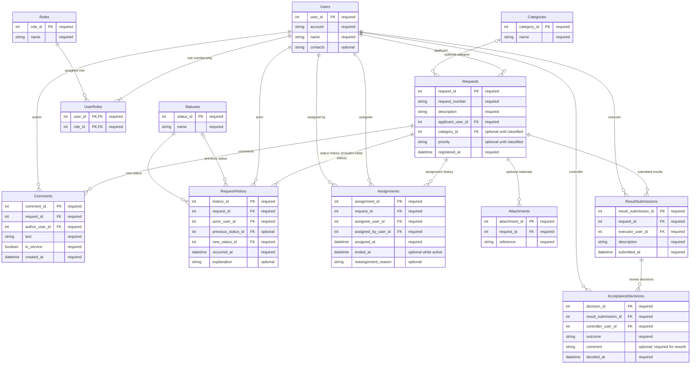

# ER-диаграмма таблиц

Логическая схема таблиц, полей и ссылок для сущностей, определённых в [концептуальной модели](../domain-entities.md). Она задаёт только необходимую структуру предметных данных, а не конкретный диалект, типы хранения или иные детали реализации БД.

В диаграмме `PK` обозначает первичный ключ, `FK` — внешний ключ. У каждого поля указано `"required"` (обязательное, NOT NULL) или `"optional"` (может отсутствовать). Первичные ключи всегда обязательны; у `UserRoles` первичный ключ составной и включает оба обязательных FK. Текущий статус определяется по последнему событию в `RequestHistory`, поэтому он не хранится вторым независимым значением в `Requests`. `RequestHistory` содержит только переходы статуса; каждое назначение/переназначение, комментарий и решение хранятся как собственные факты в соответствующих таблицах.

## Внешние ключи

Каждое поле FK ссылается на указанный первичный ключ. Условно необязательные внешние ключи сохраняют пометки `optional` из диаграммы.

| Внешний ключ | Ссылка |
|---|---|
| `UserRoles.user_id` | `Users.user_id` |
| `UserRoles.role_id` | `Roles.role_id` |
| `Requests.applicant_user_id` | `Users.user_id` |
| `Requests.category_id` | `Categories.category_id` |
| `Comments.request_id` | `Requests.request_id` |
| `Comments.author_user_id` | `Users.user_id` |
| `RequestHistory.request_id` | `Requests.request_id` |
| `RequestHistory.actor_user_id` | `Users.user_id` |
| `RequestHistory.previous_status_id` | `Statuses.status_id` |
| `RequestHistory.new_status_id` | `Statuses.status_id` |
| `Assignments.request_id` | `Requests.request_id` |
| `Assignments.assignee_user_id` | `Users.user_id` |
| `Assignments.assigned_by_user_id` | `Users.user_id` |
| `Attachments.request_id` | `Requests.request_id` |
| `ResultSubmissions.request_id` | `Requests.request_id` |
| `ResultSubmissions.executor_user_id` | `Users.user_id` |
| `AcceptanceDecisions.result_submission_id` | `ResultSubmissions.result_submission_id` |
| `AcceptanceDecisions.controller_user_id` | `Users.user_id` |

## Связи и кратности

`1:M` означает «один ко многим»: каждый экземпляр дочерней сущности относится к одному родительскому, а у родителя может быть несколько дочерних. `M:M` означает «многие ко многим».

| Родитель → дочерняя сущность | Кратность | Примечание |
|---|---|---|
| `Users` → `Requests` (заявитель) | 1:M | У заявки ровно один заявитель. |
| `Categories` → `Requests` | 1:M, необязательная со стороны заявки | У заявки ноль или одна категория до классификации; категория может быть у многих заявок. |
| `Requests` → `Comments` | 1:M | Каждый комментарий относится ровно к одной заявке. |
| `Users` → `Comments` (автор) | 1:M | У комментария ровно один автор. |
| `Users` ↔ `Roles` через `UserRoles` | M:M | Прямое M:M представлено двумя связями 1:M; `UserRoles` имеет составной PK (`user_id`, `role_id`). |
| `Requests` → `RequestHistory` | 1:M | Каждая заявка имеет начальное событие статуса и может иметь дальнейшие переходы. |
| `Users` → `RequestHistory` (автор) | 1:M | У каждого перехода ровно один автор. |
| `Statuses` → `RequestHistory` (предыдущий статус) | 1:M, необязательная для события | Предыдущий статус может отсутствовать у начального события. |
| `Statuses` → `RequestHistory` (новый статус) | 1:M | Каждый переход заканчивается ровно одним новым статусом; текущий статус заявки — новый статус последнего перехода. |
| `Requests` → `Assignments` | 1:M | Каждое назначение относится к одной заявке; история назначений сохраняется. |
| `Users` → `Assignments` (исполнитель) | 1:M | У назначения ровно один исполнитель. |
| `Users` → `Assignments` (назначивший) | 1:M | У назначения ровно один назначивший пользователь. |
| `Requests` → `Attachments` | 1:M, необязательная | Вложения у заявки могут отсутствовать; каждое вложение относится к одной заявке. |
| `Requests` → `ResultSubmissions` | 1:M | Каждое предъявление результата относится к одной заявке. |
| `Users` → `ResultSubmissions` (исполнитель) | 1:M | У предъявления ровно один автор-исполнитель. |
| `ResultSubmissions` → `AcceptanceDecisions` | 1:M | Решения относятся к одному предъявлению; до проверки у предъявления может не быть решения. |
| `Users` → `AcceptanceDecisions` (контролёр) | 1:M | У каждого решения ровно один автор-контролёр. |

`RequestHistory` содержит только переходы статуса с автором и временем; `previous_status_id` отсутствует у начального события, а `new_status_id` всегда задан. Комментарии, назначения, предъявления результата и решения о приёмке хранятся как самостоятельные факты и могут показываться вместе с переходами в общей хронологии. У каждой заявки не более одного действующего назначения. Формальное решение о приёмке принимает контролёр.

`Attachments` включена как необязательная сущность: требования разрешают прикладывать материалы к заявке, но не требуют наличия вложений; `reference` — минимальное концептуальное обозначение самого материала, не предписание формата хранения. Требования разрешают создать заявку с описанием и категорией, а оператору — проверить сведения и уточнить категорию; при этом они не уточняют, обязательно ли заявителю указывать категорию до регистрации. Поэтому `Requests.category_id` здесь допускает отсутствие до классификации оператором; если в конкретном процессе категория обязательна уже при создании, поле становится обязательным после уточнения этого правила. `Requests.priority` также может отсутствовать до классификации оператором. У контактов пользователя, причины переназначения и комментария решения нет требования быть заполненными; причина возврата на доработку обязательна по условию процесса. Отдельный справочник приоритетов и другие неоговорённые детали хранения не добавлены. Администратор, если эта необязательная роль используется, задаётся записью в `Roles` и назначением через `UserRoles`, не отдельной таблицей пользователей.

## Нормализация и проверка дублирования

- **1НФ:** поля таблиц представляют отдельные значения, а повторяющиеся группы ролей, комментариев, назначений, вложений, результатов и решений вынесены в связанные таблицы. `Users.contacts` трактуется как одно значение контакта; если потребуется хранить несколько каналов связи на пользователя, их следует моделировать отдельными записями, а не списком в поле.
- **2НФ:** атрибуты связи пользователя и роли не смешаны с данными `Users` или `Roles`; `UserRoles` содержит только пару FK, которая образует составной PK. Остальные таблицы имеют собственные ключи, а их описательные поля относятся к целой записи.
- **3НФ:** названия категорий и статусов хранятся в соответствующих справочниках, а в заявках и событиях используются FK. Пользовательские сведения хранятся один раз в `Users`; участники комментариев, назначений, истории и проверки ссылаются на эту запись.
- **Устранение избыточного текущего состояния:** `Requests` не дублирует текущий статус отдельным `current_status_id`: он выводится как `new_status_id` последнего перехода в `RequestHistory`. Для каждой заявки фиксируется начальный статус. Так исключается расхождение между текущим значением и последней записью истории.
- **История без повторного копирования фактов:** `RequestHistory` описывает только переходы статусов. `Comments`, `Assignments`, `ResultSubmissions` и `AcceptanceDecisions` остаются первичными записями своих событий; их не нужно второй раз копировать в универсальную таблицу истории. Общую ленту можно концептуально собрать из этих фактов.
- **Справочники и спорные поля:** категории и статусы являются явными справочными сущностями. Приоритет оставлен атомарным значением заявки, поскольку требования не задают устойчивый перечень приоритетов. Имя пользователя хранится в одной записи; контакты опциональны и не дробятся, пока требования не определят несколько контактов как отдельные данные.
